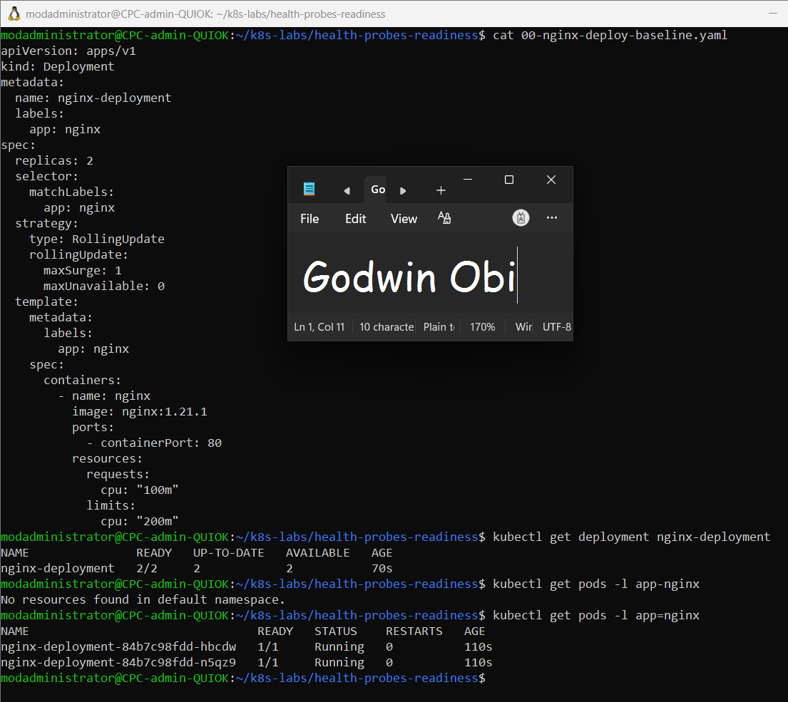
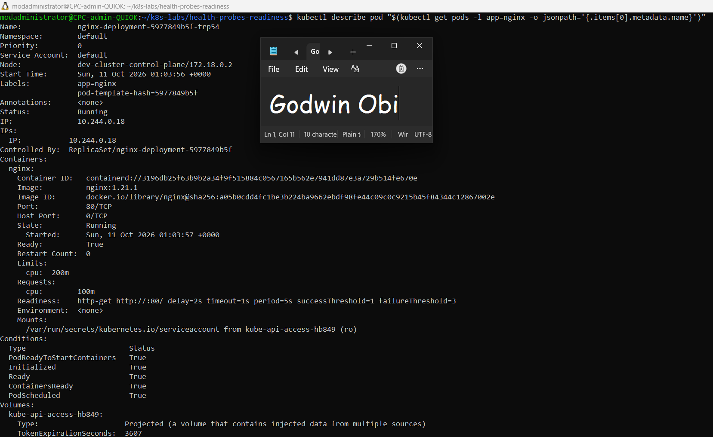
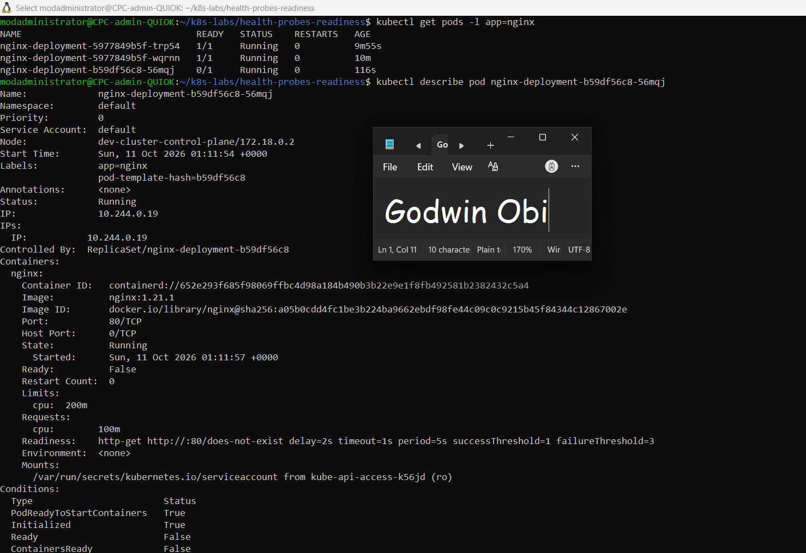
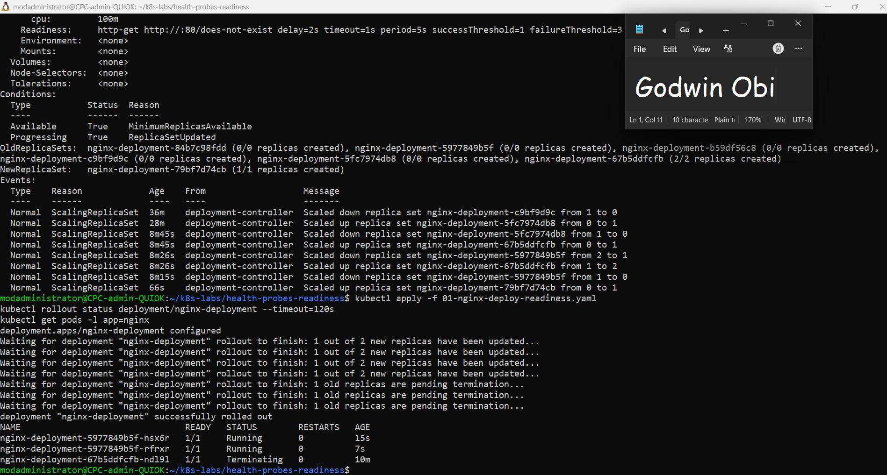
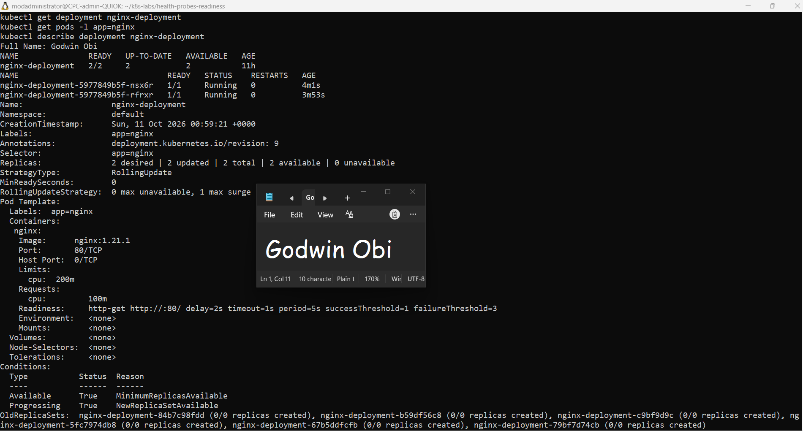

# Assignment 5 — Kubernetes Health Probes (Readiness)

Part of the DevOps Micro Internship (DMI) Cohort 3 with Agentic AI

---

## Purpose

In this guided lab, you will add an HTTP readiness probe to NGINX, intentionally break it, fix it, and prove that readiness gates Pod availability and safe rolling updates.

---

# Task 1 — Create the Baseline Deployment

## Goal

Deploy two NGINX Pods without probes (`00-nginx-deploy-baseline.yaml`) to establish the comparison state.

### Evidence

#### Screenshot 1 — Baseline manifest and healthy two-Pod rollout output

---

# Task 2 — Add the Readiness Probe

## Goal

Add an HTTP readiness probe on `/` port 80 (`01-nginx-deploy-readiness.yaml`) and confirm Pods become Ready only after it succeeds.

### Evidence

#### Screenshot 2 — Pod description showing the readiness probe and `Ready=True`

---

# Task 3 — Break and Fix Readiness

## Goal

Change the readiness path to `/does-not-exist`, observe `NotReady` and a stalled rollout, then restore the good manifest.

### Evidence

#### Screenshot 3 — `NotReady` conditions followed by a successful fixed rollout

---

# Task 4 — Prove Readiness-Gated Rolling Updates

## Goal

Perform a good image update to `nginx:1.21.2`, then attempt an update to `nginx:1.21.3` with a broken readiness patch, and confirm the rollout stalls before restoring the good spec.

### Evidence

#### Screenshot 4 — Successful good rollout, stalled broken rollout, and successful recovery

---

# Task 5 — Review Tuning and Optional Cleanup

## Goal

Review probe timing/thresholds and retain or delete the Deployment.

### Evidence

#### Screenshot 5 — Final healthy Pod state or optional cleanup output

---

### Notes

Write a short note describing what the lab demonstrated.

This lab demonstrated how Kubernetes readiness probes determine when Pods are ready to serve traffic. The baseline Deployment ran two NGINX Pods without probes. After adding an HTTP readiness probe, I intentionally configured an invalid path and observed that the new Pod became NotReady while the rollout stalled. Restoring the valid probe allowed the Deployment to recover. I also demonstrated how readiness checks and `maxUnavailable: 0` help protect existing healthy Pods during rolling updates. The requested `nginx:1.21.2` image was unavailable, so I used the verified `nginx:1.21.6` image for the successful update test.

---

# Submission Instructions

- Add all required screenshots in your submission
- Include the completed YAML manifests used in the lab

---

# Completion Checklist

- [ ] Task 1: Baseline Deployment applied (Screenshot 1)
- [ ] Task 2: Readiness probe added and verified (Screenshot 2)
- [ ] Task 3: Readiness broken and fixed (Screenshot 3)
- [ ] Task 4: Readiness-gated rolling update proven (Screenshot 4)
- [ ] Task 5: Tuning reviewed / cleanup completed (Screenshot 5)
- [ ] Reflection notes written (Notes)

---

## 📌 About DMI & CloudAdvisory

DevOps Micro Internship (DMI) is a project-based DevOps program run by Pravin Mishra (The CloudAdvisory) focused on real-world execution, systems thinking, and career readiness.

It helps learners build strong DevOps foundations with hands-on experience.

---

## 📌 Resources

- 🌐 DMI Official Website: https://dmi.pravinmishra.com?utm_source=github&utm_medium=readme  
- 🎓 University: https://university.pravinmishra.com?utm_source=github&utm_medium=readme  
- 💬 Discord Community: https://discord.pravinmishra.com?utm_source=github&utm_medium=readme  
- 📝 Blog: https://dmi.pravinmishra.com/blog?utm_source=github&utm_medium=readme  
- ▶️ YouTube Playlist: https://www.youtube.com/playlist?list=PLFeSNDtI4Cho  
- 🔗 Pravin Mishra (LinkedIn): https://www.linkedin.com/in/pravin-mishra-aws-trainer/  
- 🏢 CloudAdvisory (LinkedIn): https://www.linkedin.com/company/thecloudadvisory/

---

*This submission is part of DevOps Micro Internship (DMI) Cohort 3 — Agentic AI Track.*
