# Assignment 10 — Capstone: Deploy the Book Review App to Kubernetes

Part of the DevOps Micro Internship (DMI) Cohort 3 with Agentic AI

---

## Purpose

In this capstone assignment, you will deploy the Book Review App as a production-style three-tier application on Kubernetes (EKS, AKS, GKE, Minikube, or k3s): a Next.js frontend behind Nginx exposed publicly, an internal Node.js/Express backend on port 3010, and a persistent or managed MySQL database — configured with ConfigMaps, Secrets, and validated end to end.

---

# Task 1 — Prepare the Kubernetes Cluster and Tooling

## Goal

Select a Kubernetes platform, confirm `kubectl` (and Helm, if used) can communicate with the cluster, and verify nodes are Ready.

### Evidence

#### Screenshot 1 — Terminal showing the active Kubernetes context and Ready nodes

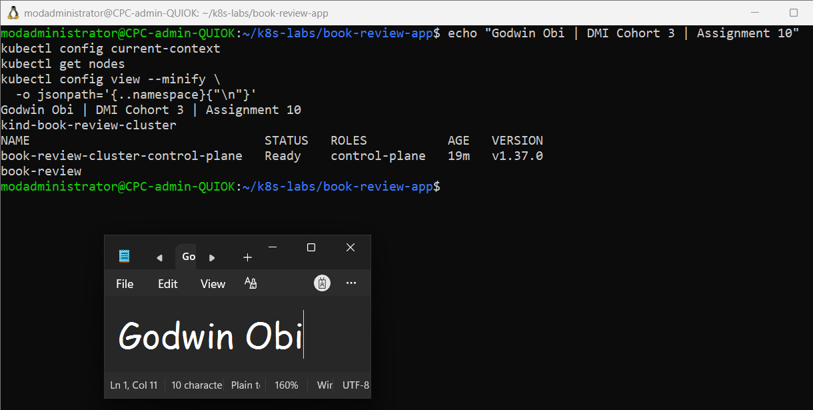

---

#### Screenshot 2 (if using Helm) — Terminal showing `helm version`

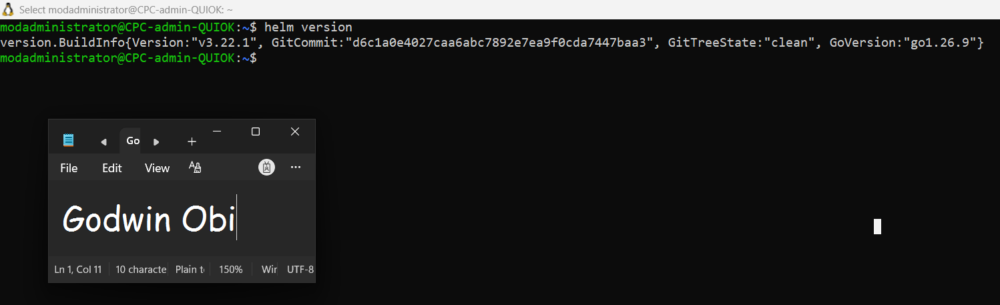

---

# Task 2 — Design the Three-Tier Kubernetes Architecture

## Goal

Create an architecture diagram showing the public entry point, frontend, internal backend, MySQL, ConfigMaps/Secrets, and the permitted traffic flow.

### Evidence

#### Screenshot 3 — Completed Kubernetes architecture diagram

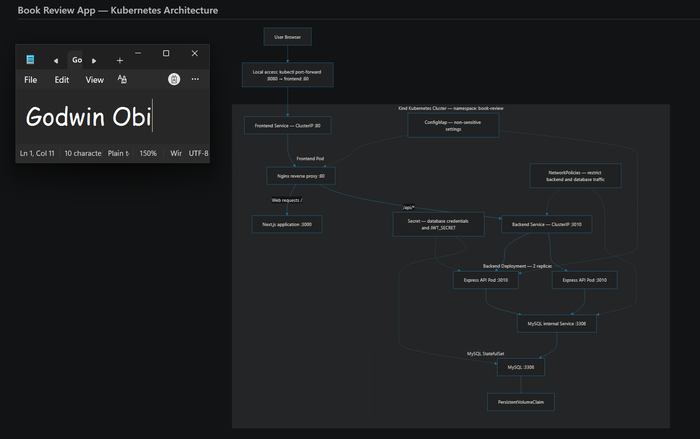

---

# Task 3 — Create ConfigMaps and Secrets

## Goal

Externalize non-sensitive configuration into ConfigMaps and sensitive values (database credentials, JWT secret) into Secrets, referenced from the Pod specs without committing plaintext values.

### Evidence

#### Screenshot 4 — ConfigMap manifest or `kubectl describe configmap` output showing non-sensitive configuration

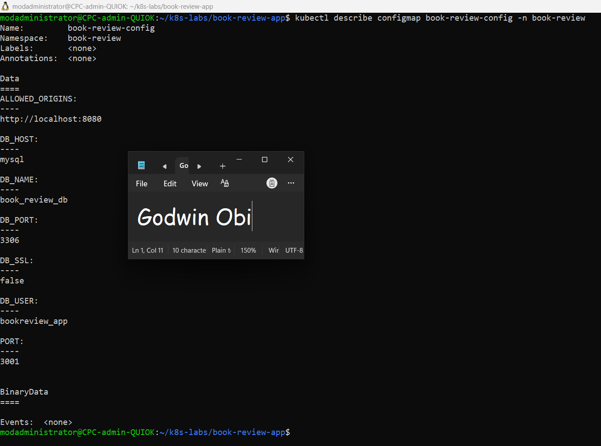

---

#### Screenshot 5 — Secret object usage with sensitive values hidden or redacted

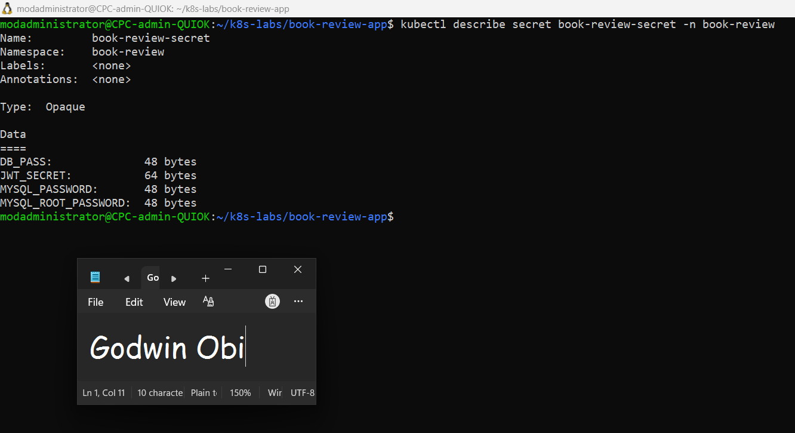

---

# Task 4 — Deploy and Configure the MySQL Data Tier

## Goal

Provide a persistent MySQL database (managed service or StatefulSet + PVC) reachable only by the backend, initialize the schema, and test connectivity.

### Evidence

#### Screenshot 6 — Managed MySQL status or MySQL StatefulSet/PVC status

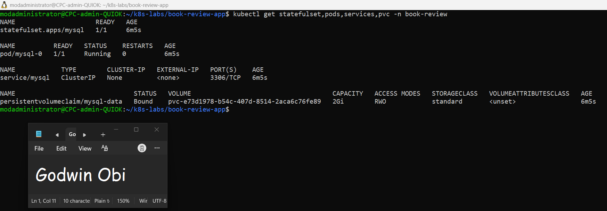

---

#### Screenshot 7 — Successful database connectivity or schema verification with credentials hidden

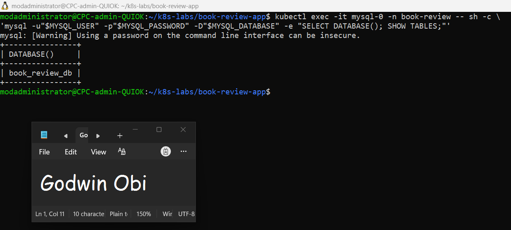

---

# Task 5 — Deploy the Backend Application Tier

## Goal

Run one or two Node.js/Express backend replicas on port 3010, expose them via ClusterIP (or internal LoadBalancer), and connect them to MySQL using ConfigMaps/Secrets.

### Evidence

#### Screenshot 8 — Backend Deployment, Pods, and internal Service

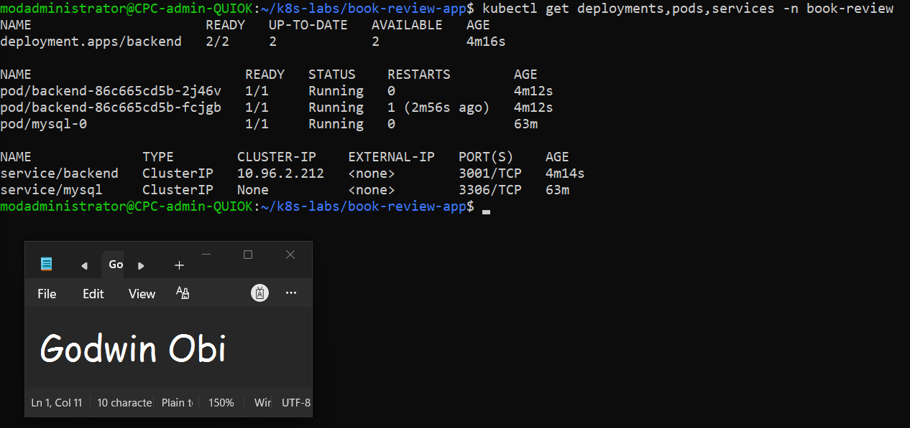

---

#### Screenshot 9 — Backend logs showing successful startup and database connectivity

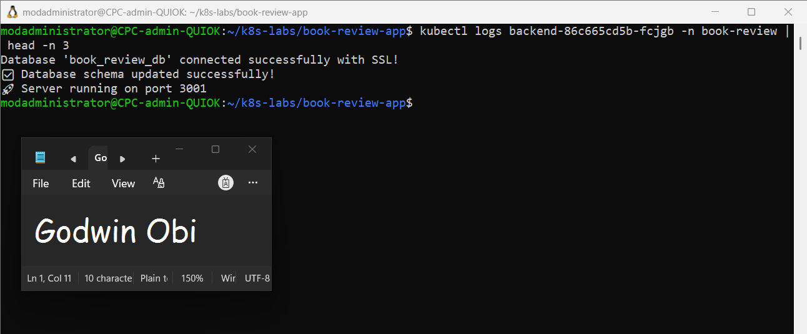

---

# Task 6 — Deploy the Frontend and Configure Nginx

## Goal

Run one or two Next.js frontend replicas behind Nginx on port 80, reverse-proxying to the backend's internal Service name.

### Evidence

#### Screenshot 10 — Frontend Deployment and Ready Pods

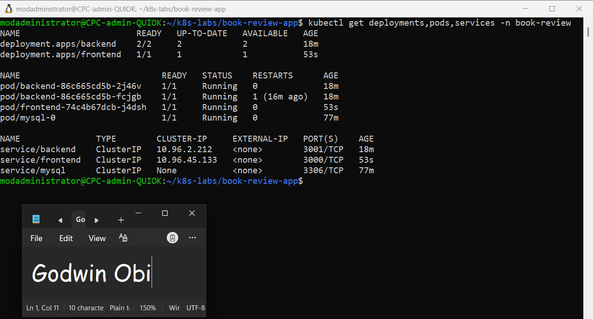

---

#### Screenshot 11 — Nginx reverse-proxy configuration showing the internal backend Service name

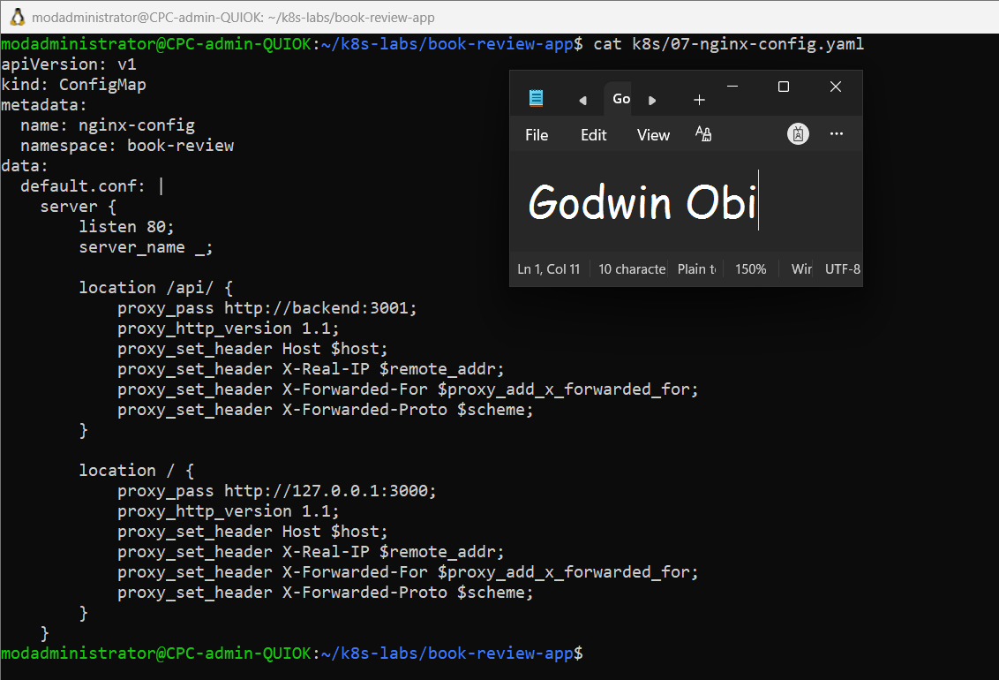

---

# Task 7 — Configure External and Internal Networking

## Goal

Expose only the frontend publicly (LoadBalancer or Ingress), restrict backend access to the frontend path (NetworkPolicy or platform equivalent), and confirm MySQL is not publicly reachable.

### Evidence

#### Screenshot 12 — Frontend LoadBalancer or Ingress showing the public endpoint

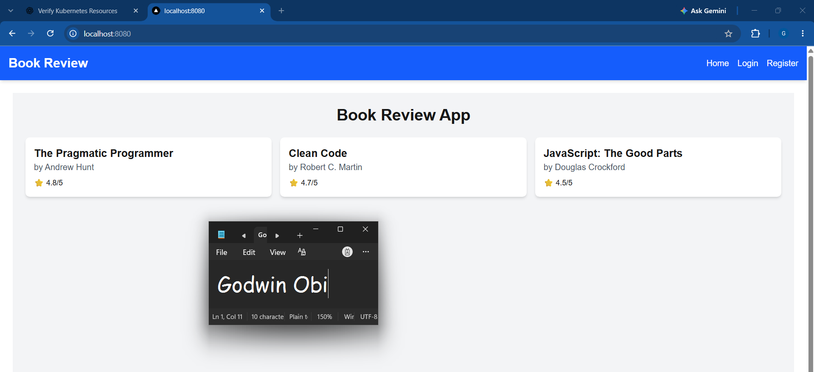

---

#### Screenshot 13 — Internal backend Service and NetworkPolicy (or equivalent restriction)

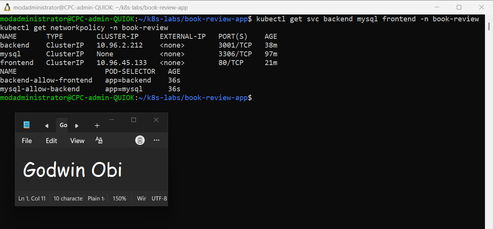

---

# Task 8 — Validate the Application End to End

## Goal

Confirm the frontend loads publicly, a full user flow reaches the backend and MySQL, and collect operational evidence.

### Evidence

#### Screenshot 14 — `kubectl get all` output

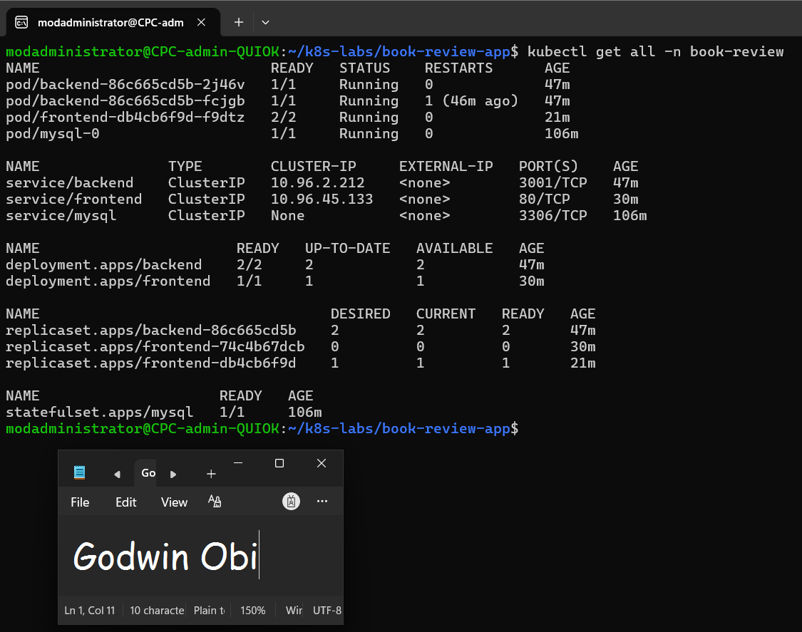

---

#### Screenshot 15 — Functional Book Review App in the browser with the public URL or IP visible

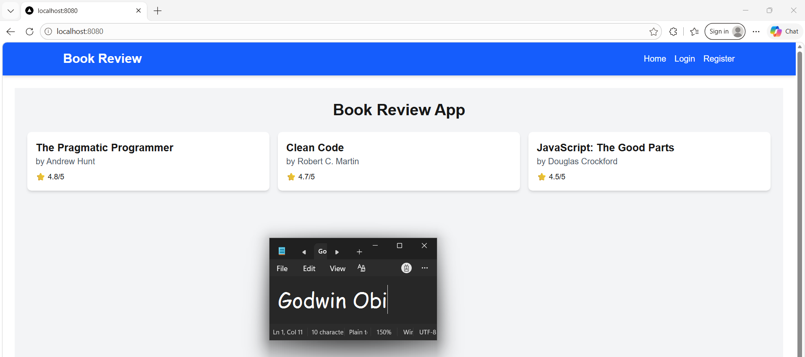

---

#### Screenshot 16 — Frontend Pod logs

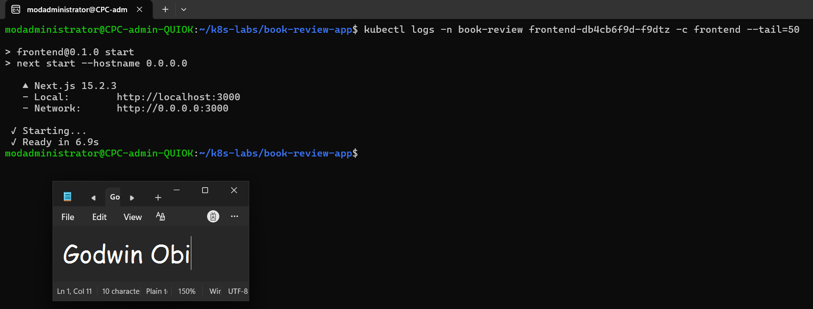

---

#### Screenshot 17 — Backend Pod logs showing successful requests or database activity

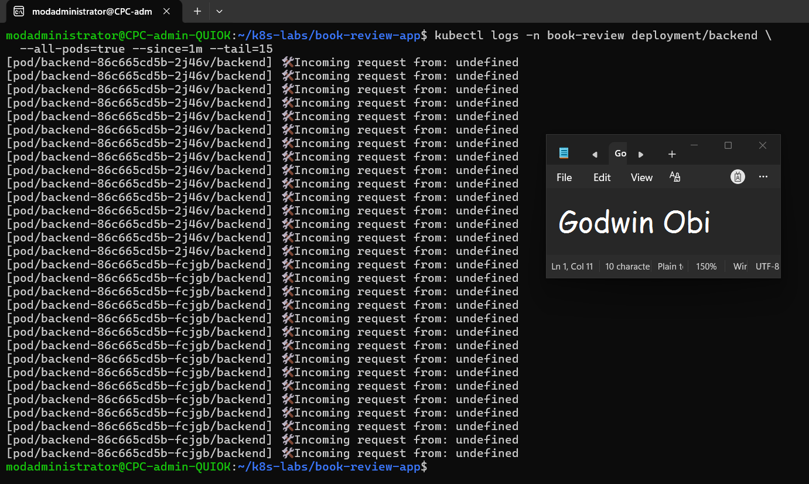

---

#### Screenshot 18 (optional) — Kubernetes dashboard

Not implemented. Kubernetes resources were managed and monitored using kubectl commands in the terminal. Deployment status, Pod health, Services, persistent storage, and application logs were verified through the Kubernetes CLI.

---

# Task 9 — Implement Optional Production Enhancements

## Goal

Optionally package as a Helm chart, add HPA, add readiness/liveness probes, or configure TLS via cert-manager — without changing the core architecture.

### Evidence

#### Screenshot 19 (optional) — Helm release, HPA, probes, or TLS evidence

Optional production enhancements, such as Helm packaging, Horizontal Pod Autoscaling (HPA), and TLS configuration, were not implemented as part of this deployment. The core application was deployed using Kubernetes manifests, with ConfigMaps, Secrets, persistent MySQL storage, Nginx reverse proxy configuration, and NetworkPolicies. Health probes and other production hardening measures can be added in a future iteration.

---

### Notes

Report the Kubernetes platform used, the public frontend URL/IP, a GitHub link to your manifests/Helm chart (if applicable), and the architecture diagram link. Summarize what worked, issues encountered and how they were resolved, and the tools/sources that helped the most.

## Notes

### Kubernetes Platform
Deployed the Book Review App on a local Kubernetes cluster using **Kind (Kubernetes in Docker)**, managed with `kubectl`.

### Frontend URL
**Local URL:** http://localhost:8080

The frontend was accessed through Kubernetes port-forwarding to the frontend Service. This is a local endpoint, not a publicly accessible IP address or URL.

### GitHub Repository and Architecture Diagram
- **GitHub Repository:** https://github.com/GodLoN/book-review-app.git
- **Architecture Diagram:** 

### Implementation Summary
Successfully deployed the three-tier Book Review App on Kubernetes, consisting of a Next.js frontend behind an Nginx reverse proxy, a Node.js/Express backend, and a MySQL database.

Kubernetes ConfigMaps and Secrets were used to separate application configuration from sensitive credentials. MySQL was deployed using a StatefulSet and PersistentVolumeClaim. ClusterIP Services enabled internal communication, while NetworkPolicies restricted traffic to the backend and database tiers.

### Validation
Verified that the Kubernetes nodes and application Pods were running, the MySQL database `book_review_db` existed, and persistent storage was bound. Confirmed that the frontend loaded in a browser and that API requests returned book data through the Nginx reverse proxy.

### Challenges and Resolutions
- **Frontend and backend communication:** Configured Nginx to proxy API requests to the internal backend Service.
- **Configuration management:** Used ConfigMaps for non-sensitive settings and Kubernetes Secrets for sensitive values.
- **Database persistence:** Deployed MySQL with a StatefulSet and PersistentVolumeClaim.
- **External access:** Used `kubectl port-forward` to access the frontend locally because the Kind cluster does not provide a public LoadBalancer endpoint by default.

### Tools and Learning Resources
- Kubernetes, Kind, `kubectl`, Docker, and YAML manifests
- Nginx reverse proxy and Kubernetes Services
- ConfigMaps, Secrets, StatefulSets, PersistentVolumeClaims, and NetworkPolicies
- DMI Cohort 3 course materials and the official Kubernetes documentation

### Future Improvements
Potential enhancements include deploying to a managed cloud Kubernetes service, configuring a public Ingress or LoadBalancer endpoint with TLS, adding health probes and autoscaling, and packaging the deployment as a Helm chart.

---

# Submission Instructions

- Add all required screenshots and links in your submission
- Do not display decoded Secret values in screenshots or the report

---

# Completion Checklist

- [ ] Task 1: Cluster and tooling verified (Screenshots 1–2)
- [ ] Task 2: Architecture diagram completed (Screenshot 3)
- [ ] Task 3: ConfigMaps and Secrets created (Screenshots 4–5)
- [ ] Task 4: MySQL data tier deployed and verified (Screenshots 6–7)
- [ ] Task 5: Backend tier deployed internally (Screenshots 8–9)
- [ ] Task 6: Frontend deployed behind Nginx (Screenshots 10–11)
- [ ] Task 7: External/internal networking configured (Screenshots 12–13)
- [ ] Task 8: End-to-end validation completed (Screenshots 14–18)
- [ ] Task 9: Optional production enhancements documented (Screenshot 19)
- [ ] Report completed (Notes)
- [ ] No sensitive information exposed

---

## 📌 About DMI & CloudAdvisory

DevOps Micro Internship (DMI) is a project-based DevOps program run by Pravin Mishra (The CloudAdvisory) focused on real-world execution, systems thinking, and career readiness.

It helps learners build strong DevOps foundations with hands-on experience.

---

## 📌 Resources

- 🌐 DMI Official Website: https://dmi.pravinmishra.com?utm_source=github&utm_medium=readme  
- 🎓 University: https://university.pravinmishra.com?utm_source=github&utm_medium=readme  
- 💬 Discord Community: https://discord.pravinmishra.com?utm_source=github&utm_medium=readme  
- 📝 Blog: https://dmi.pravinmishra.com/blog?utm_source=github&utm_medium=readme  
- ▶️ YouTube Playlist: https://www.youtube.com/playlist?list=PLFeSNDtI4Cho  
- 🔗 Pravin Mishra (LinkedIn): https://www.linkedin.com/in/pravin-mishra-aws-trainer/  
- 🏢 CloudAdvisory (LinkedIn): https://www.linkedin.com/company/thecloudadvisory/

---

*This submission is part of DevOps Micro Internship (DMI) Cohort 3 — Agentic AI Track.*
