# Assignment 11 — AI-Assisted Kubernetes Incident Triage

Part of the DevOps Micro Internship (DMI) with Agentic AI

---

## Purpose

Configure a read-only Bash triage script for your Book Review App, connect it to Claude Code through `/k8s-triage`, simulate one controlled failure, recover the application manually, and verify recovery.

**Workflow: Gather → Analyze → Human Act → Verify**

---

## Submission Details

**Full Name:** Godwin Obi

**Kubernetes Platform:** Kubernetes running locally on a Kind cluster.

**Selected Workload:** backend Deployment

**Namespace:** book-review

**GitHub Repository URL:** https://github.com/GodLoN/ai-assisted-kubernetes-incident-triage

**Simulated Incident:** Invalid container image (`book-review-backend:incident-invalid`), resulting in `ErrImagePull` and `ImagePullBackOff`.

**Baseline Status:** WARN — The initial triage report recorded 4 PASS, 2 WARN, and 0 FAIL. The workload was available, but historical restarts and health-probe timeouts required investigation..

**Recovery Status:** WARN — The final triage report recorded 4 PASS, 2 WARN, and 0 FAIL. Both backend Pods were Running and 1/1 ready, and the Service had two ready endpoints. Historical restarts and health-probe timeout warnings remained for further investigation.

---

# Task 1 — Discover the Application and Capture a Healthy Baseline

## Goal

Identify the actual application configuration and prove that the selected workload is healthy before incident simulation.

### Evidence

#### Screenshot 1 — Healthy Pods and ready Service backends

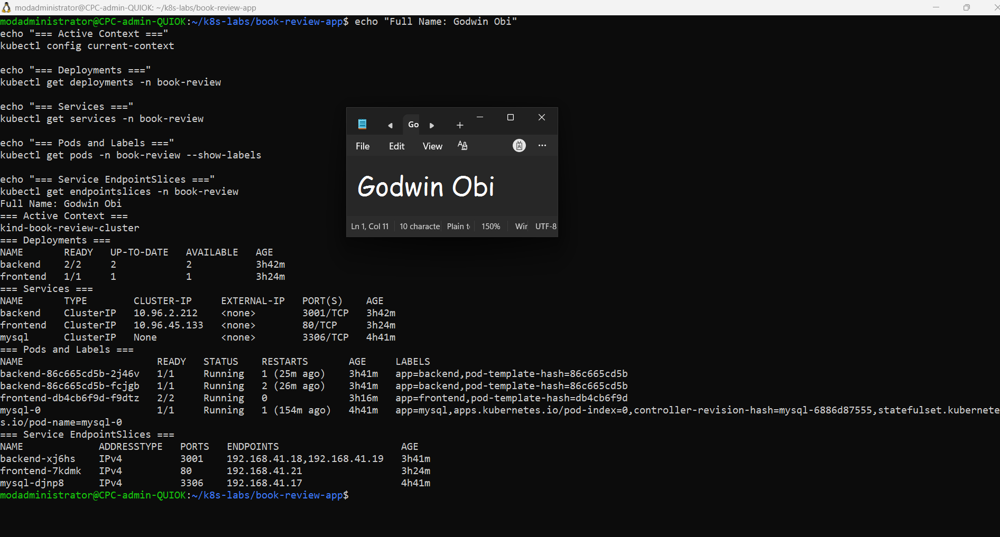

---

#### Screenshot 2 — Workspace directory structure

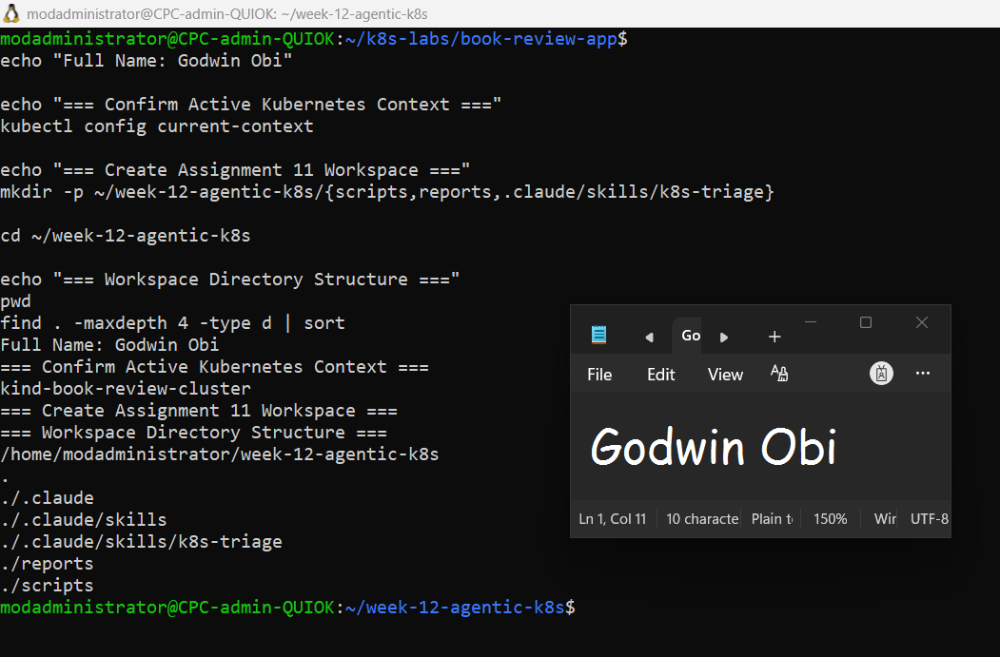

### Notes

**1. What proves the selected Pods are ready, not merely running?**

Both backend Pods show `STATUS = Running` and `READY = 1/1`, confirming that their containers are running and have passed their readiness checks.

**2. What proves the Service has ready backends?**

The backend Service's EndpointSlice lists both Pod IP addresses (`192.168.41.18` and `192.168.41.19`) with `conditions.ready: true`, confirming that both Pods are available as Service backends.

**3. Why must the original image be recorded before incident simulation?**

Recording the original working image, `book-review-backend:local`, ensures that I can restore the Deployment to its known-good configuration after simulating an invalid-image incident. It also provides evidence of the original configuration for recovery and verification.

---

# Task 2 — Configure CLAUDE.md

## Goal

Define the project configuration, incident workflow, and safety boundary for Claude Code.

### Evidence

#### Screenshot 3 — CLAUDE.md showing application configuration, workflow, safety rules, and output rules

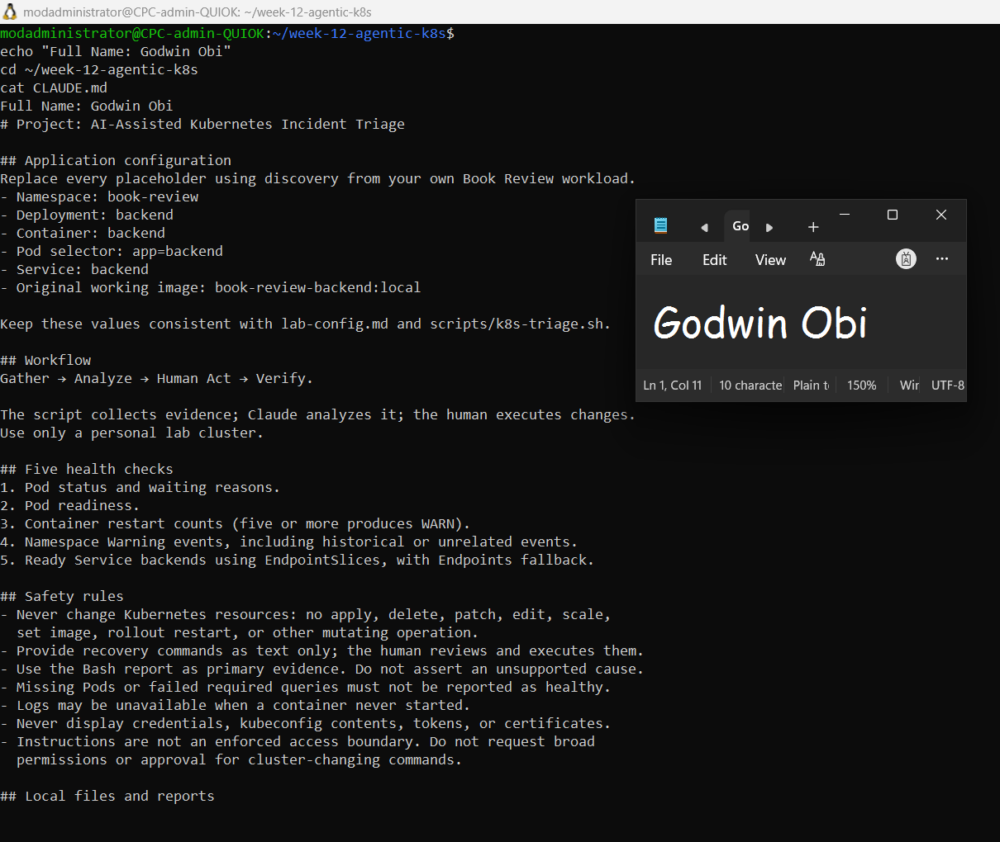

### Notes

**1. Why does Claude need project-specific cluster rules?**

Project-specific rules ensure Claude uses the correct Kubernetes context, namespace, Deployment, container, Pod selector, Service, and original image, preventing incorrect recommendations.

**2. Why must a human execute recovery commands?**

Human execution maintains control over cluster changes, allowing the proposed action to be reviewed and approved before execution and preventing unintended changes or service disruptions.

**3. Which rule prevents an unsupported diagnosis?**

The rule **“Use the Bash report as primary evidence. Do not assert an unsupported cause.**” ensures Claude bases its diagnosis on collected evidence rather than assumptions.

---

# Task 3 — Plan the Read-Only Triage Workflow

## Goal

Ask Claude Code to explain the five health checks before running the supplied script.

### Evidence

#### Screenshot 4 — Claude Code showing the five-check read-only plan

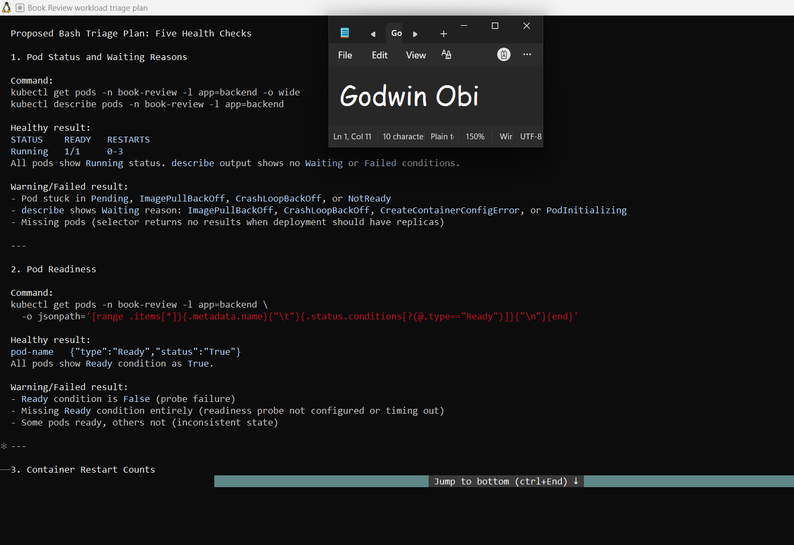

### Notes

**1. Which part represents the Gather phase?**

The Gather phase collects evidence using read-only Kubernetes commands to inspect Pod status, readiness, restart counts, namespace Warning events, and ready Service backends.

**2. How did you verify that Claude did not change anything?**

I reviewed Claude’s response and tool activity to confirm that it only inspected the workload and proposed commands without modifying files or Kubernetes resources.

**3. Why is planning before coding useful for incident triage?**

Planning identifies the required checks and expected healthy or unhealthy results before implementation, helping prevent missed evidence, unsupported diagnoses, and unsafe recovery actions.

---

# Task 4 — Configure and Validate the Bash Script

## Goal

Configure the supplied triage script for the selected workload and validate its syntax.

### Evidence

#### Screenshot 5 — Script configuration variables and checks array

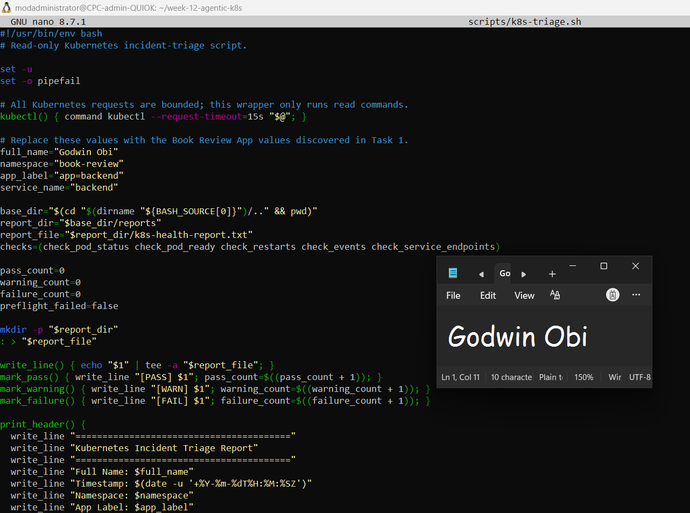

---

#### Screenshot 6 — Functions for status, readiness, restarts, events, and Service backends

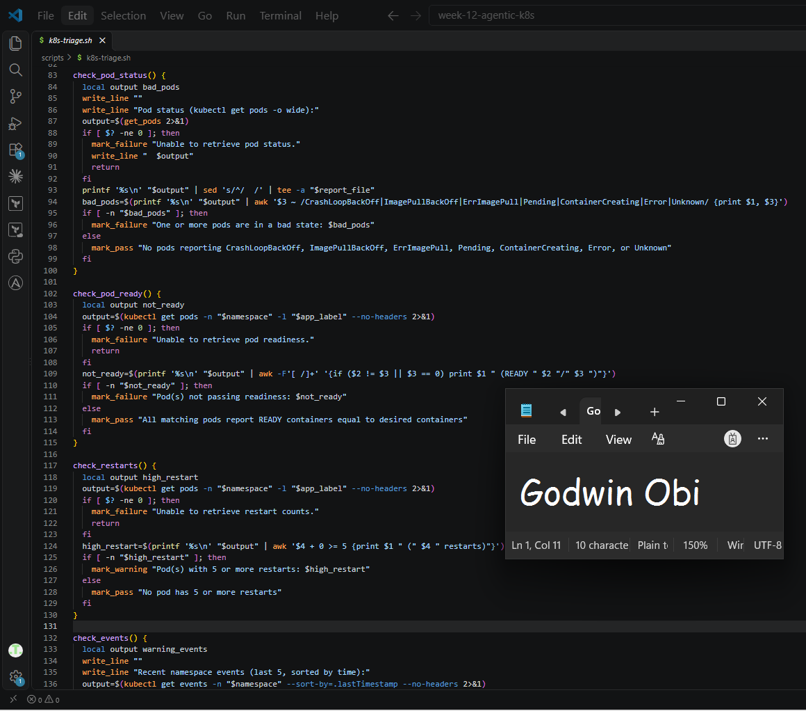

---

#### Screenshot 7 — Preflight, summary, and exit-code logic

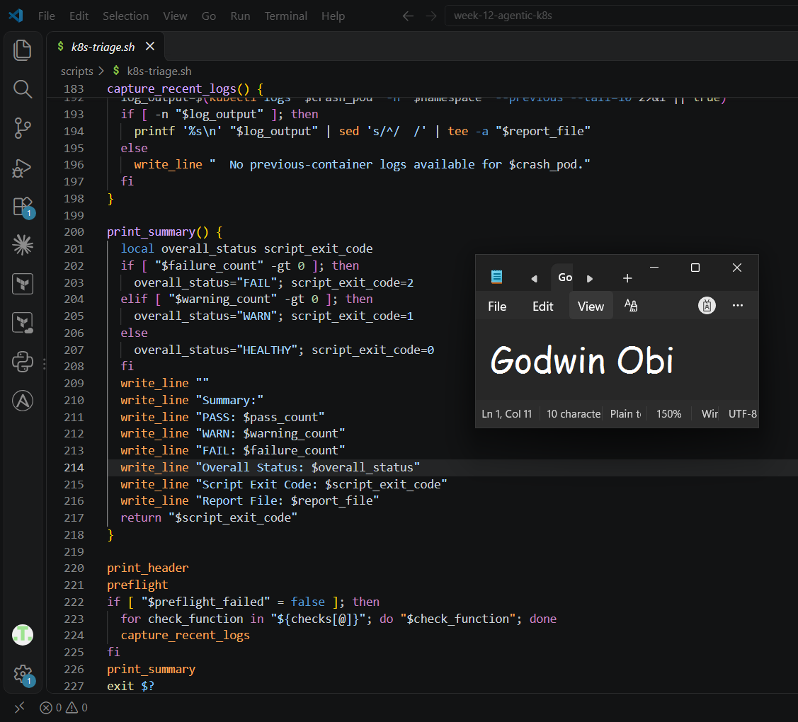

---

#### Screenshot 8 — Successful syntax validation and executable permission

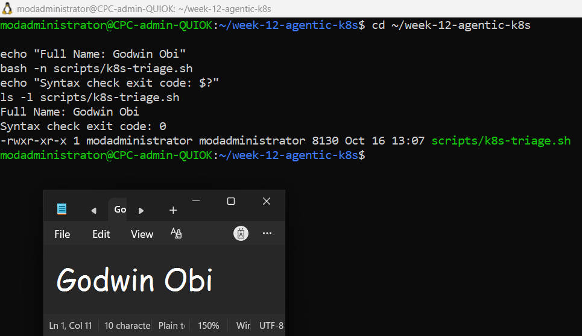

### Notes

**1. Why must the script fail when no Pods match the configured selector?**

The script must fail because it cannot collect valid health evidence when no Pods match. This prevents an empty or incorrectly selected workload from being reported as healthy.

**2. How does the readiness check detect a running but unready Pod?**

It compares the number of ready containers with the total number of containers. If a Pod shows `0/1` instead of `1/1`, it detects that the Pod is not ready even if its status is `Running`.

**3. Why are Service backends checked separately from Pod health?**

Running and ready Pods do not guarantee that the Service can route traffic to them. Checking EndpointSlices or Endpoints confirms whether the Service has ready backends available.

**4. What do exit codes 0, 1, and 2 represent?**

*  **Exit code 0 — HEALTHY:** All checks passed with no warnings or failures.
*  **Exit code 1 — WARN:** One or more warnings were detected, but no checks failed.
*  **Exit code 2 — FAIL:** One or more checks failed, indicating a problem requiring investigation.

---

# Task 5 — Run the Healthy Baseline Report

## Goal

Run the script on the healthy application and confirm that it contains no failed checks.

### Evidence

#### Screenshot 9 — Baseline report showing your full name and all checks

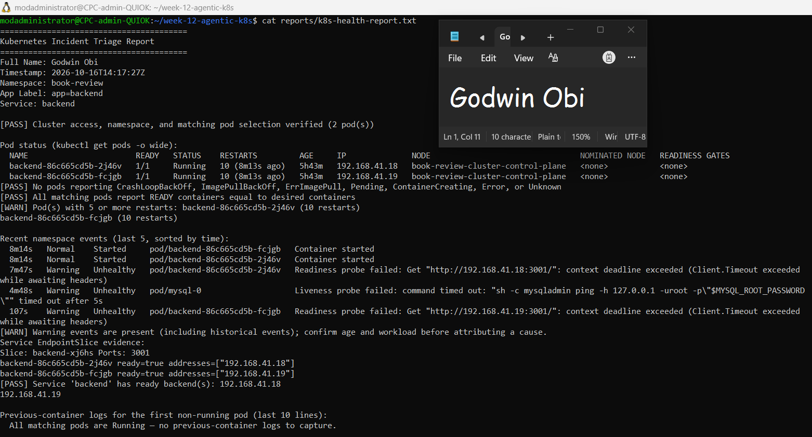

---

#### Screenshot 10 — Captured exit code and final summary

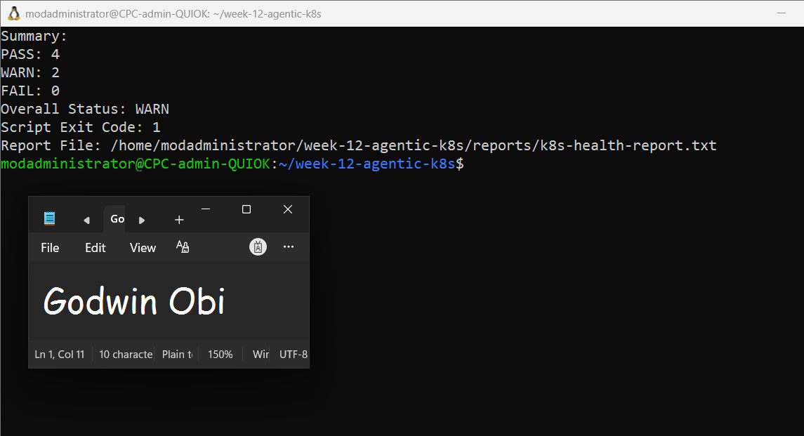

### Notes

**1. What is the baseline status?**

The baseline status is `WARN`, with 4 PASS checks, 2 WARN checks, and 0 FAIL checks. Both backend Pods are Running and Ready, and the Service has two ready backends. However, both Pods have 10 restarts, and recent readiness and MySQL liveness probe timeouts require further investigation.

**2. Which evidence proves the Service has a ready backend?**

The EndpointSlice backend-xj6hs lists both backend Pods with `ready=true` and addresses `192.168.41.18` and `192.168.41.19`, confirming that the Service currently has ready backends.

**3. What is the difference between a warning and a failure?**

A warning indicates a condition that requires review but does not necessarily mean the workload is currently unavailable. A failure indicates a critical check failed. The baseline returned exit code `1` because warnings were present, despite having no failed checks.

---

# Task 6 — Configure and Run the Claude Code Skill

## Goal

Connect the Bash script to a manually invoked Claude Code evidence-analysis workflow.

### Evidence

#### Screenshot 11 — SKILL.md showing frontmatter and safety rules

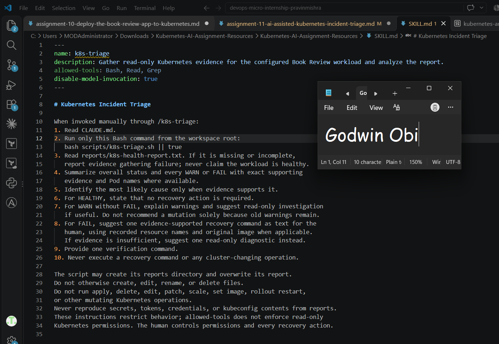

---

#### Screenshot 12 — Baseline `/k8s-triage` analysis

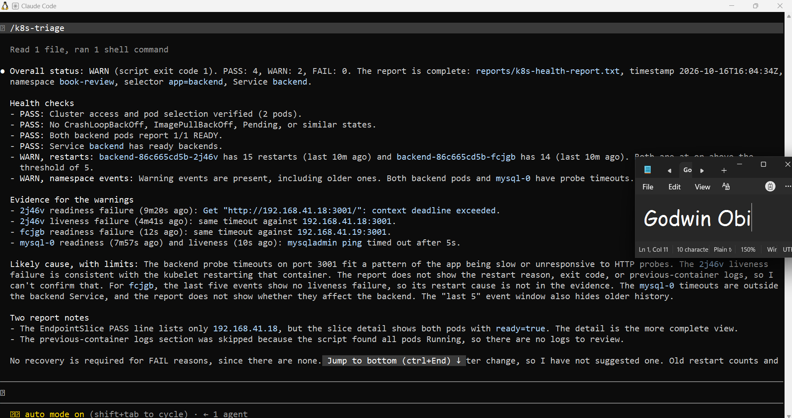

### Notes

**1. What does Bash do in this workflow?**

Bash runs the read-only Kubernetes triage script, gathers Pod status, readiness, restart counts, Warning events, and Service backend evidence, then saves the findings in a report with an exit code.

**2. What does Claude do in this workflow?**

Claude reads the project instructions and Bash report, summarizes the health-check results, interprets warnings using the available evidence, identifies possible causes with appropriate uncertainty, and suggests read-only diagnostics or a manual recovery command when justified.

**3. Why are instructions alone insufficient to guarantee read-only access?**

Instructions guide Claude's behavior but do not technically enforce permissions. The tools and credentials available to Claude may still allow changes. Read-only access should also be enforced through appropriate Kubernetes RBAC permissions and restricted credentials.

---

# Task 7 — Simulate One Controlled Incident

## Goal

Create one controlled failure, save its evidence, and let Claude analyze it without executing recovery.

### Evidence

#### Screenshot 13 — Failed or unready Pod evidence and current Service backends

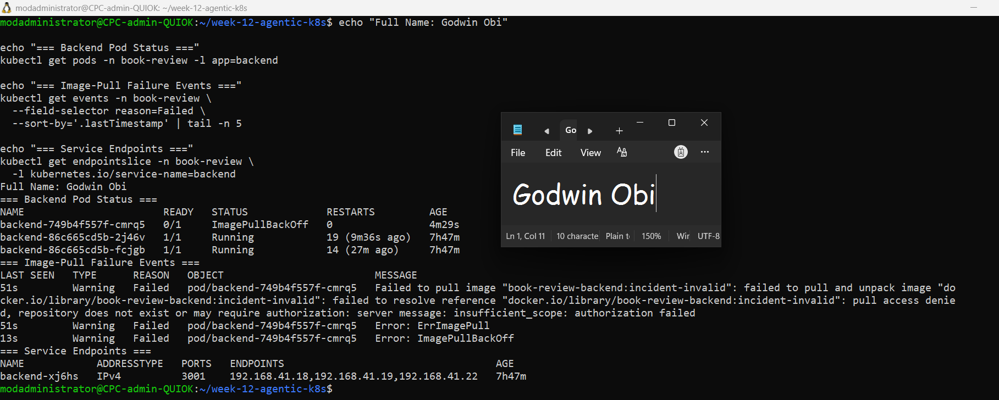

---

#### Screenshot 14 — Failed `/k8s-triage` analysis with evidence and a suggested manual recovery command

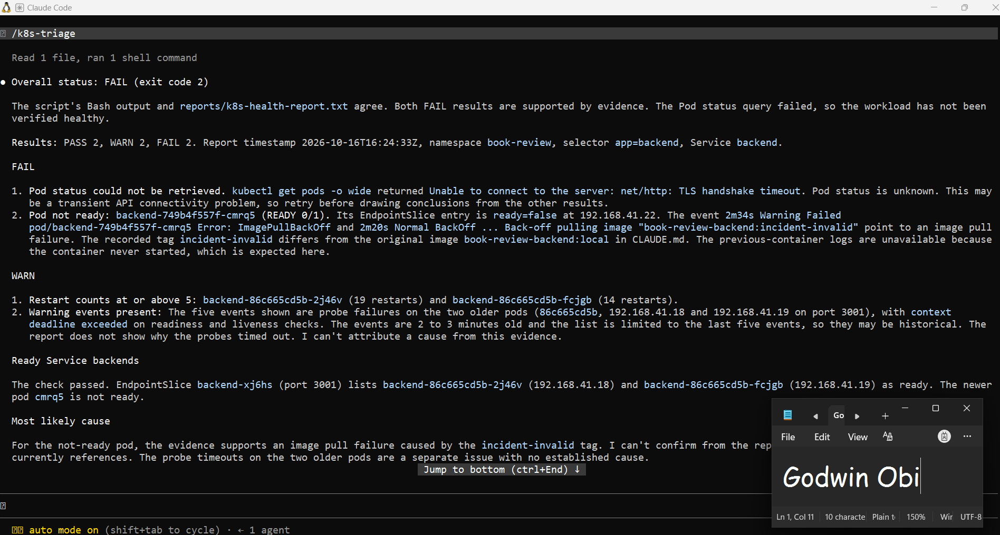

---

#### Screenshot 15 — Saved `incident-failure-report.txt`

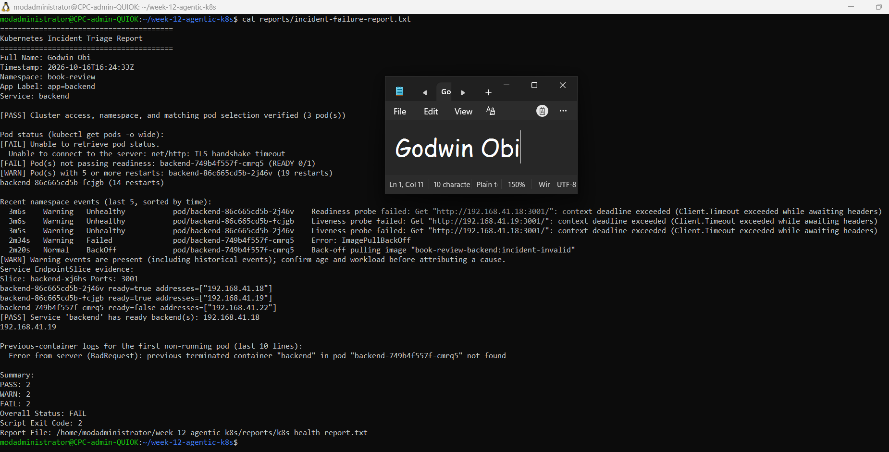

### Notes

**1. Which failure did you choose?**

I deliberately updated the backend Deployment to use the nonexistent image `book-review-backend:incident-invalid`, creating a controlled image-pull failure.

**2. Which checks failed, and what evidence proved it?**

The Pod status check failed because Pod `backend-749b4f557f-cmrq5` entered `ErrImagePull`. The readiness check failed because the Pod showed` 0/1` Ready. The EndpointSlice listed the failed Pod with `ready=false`. The triage summary reported `FAIL: 2` and `Overall Status: FAIL`, with `exit code 2`.

**3. Did Claude execute recovery? Why is that important?**

No. Claude analyzed the report and provided diagnostic guidance without running a mutating Kubernetes command. This keeps recovery under human control, allowing the operator to verify the proposed action before applying it.

**4. Why might the Service retain ready backends during the incident?**

The Deployment uses a rolling update, so the two original backend Pods remained Running and ready while Kubernetes attempted to start the replacement Pod. The Service could therefore retain those ready endpoints even though the new Pod had an image-pull failure.

---

# Task 8 — Recover Manually and Verify

## Goal

Restore the healthy configuration yourself and verify recovery using a second triage report.

### Evidence

#### Screenshot 16 — Recovered Pods and ready Service backends

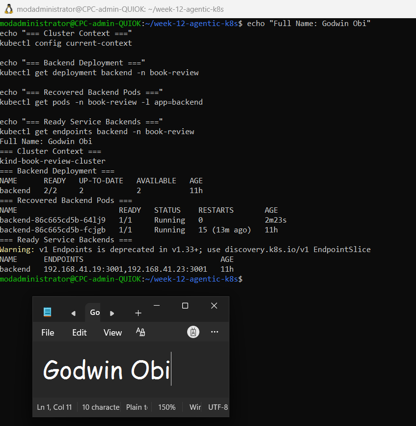

---

#### Screenshot 17 — Recovered `/k8s-triage` analysis

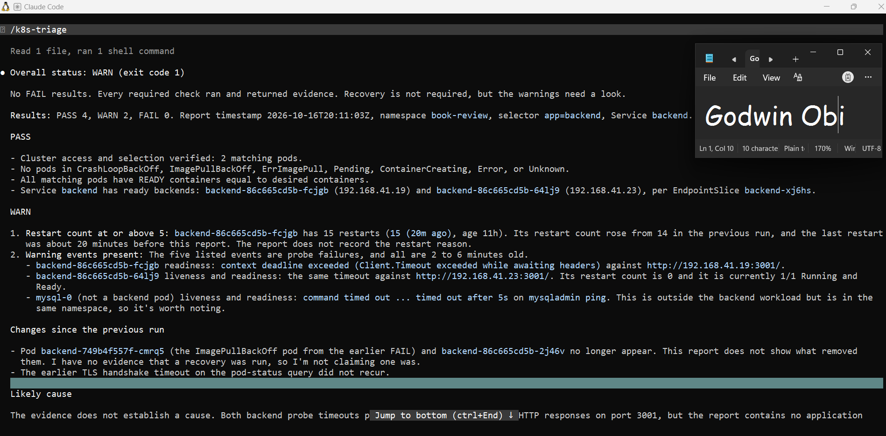

---

#### Screenshot 18 — Reports directory showing failure and recovery reports

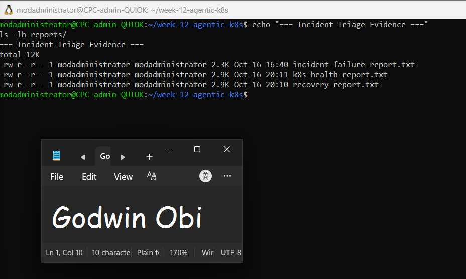

---

#### Screenshot 19 — `incident-summary.md` with all required sections

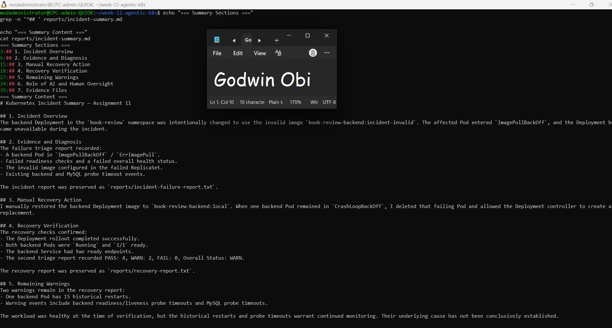

### Notes

**1. What manual recovery action did you execute?**

I restored the backend Deployment image to book-review-backend:local. When one backend Pod remained in CrashLoopBackOff, I manually deleted that failing Pod and allowed the Deployment controller to create a replacement.

**2. What proves the workload recovered?**

The Deployment rollout completed successfully. Both backend Pods were Running and 1/1 ready, and the backend Service had two ready endpoints. The second triage report recorded PASS: 4, WARN: 2, FAIL: 0.

**3. Why is the second triage run necessary?**

The second triage run independently verifies the workload after manual recovery. It provides fresh evidence of Pod readiness, Service endpoints, and remaining warnings instead of assuming recovery succeeded because a command completed.

**4. Why should AI not automatically restart every failing production workload?**

Automatic restarts can disrupt healthy traffic, increase downtime, hide the underlying cause, or affect dependent services. AI should gather and analyze evidence, while recovery actions follow approved procedures and appropriate human oversight.

### Remaining WARN Results

Explain any WARN results remaining after recovery, or write “None.”

Two warnings remain: one backend Pod has 15 historical restarts, and warning events include backend health-probe timeouts and MySQL probe timeouts. Both backend Pods were healthy during final verification, but the underlying causes of the historical restarts and probe timeouts have not been conclusively established.

---

# Task 9 — Publish Your Kubernetes Incident-Triage Workflow on LinkedIn

## Goal

Share the incident-triage workflow you completed and explain the role of human control.

### Evidence

#### Screenshot 20 — Published LinkedIn post about your Kubernetes incident-triage workflow

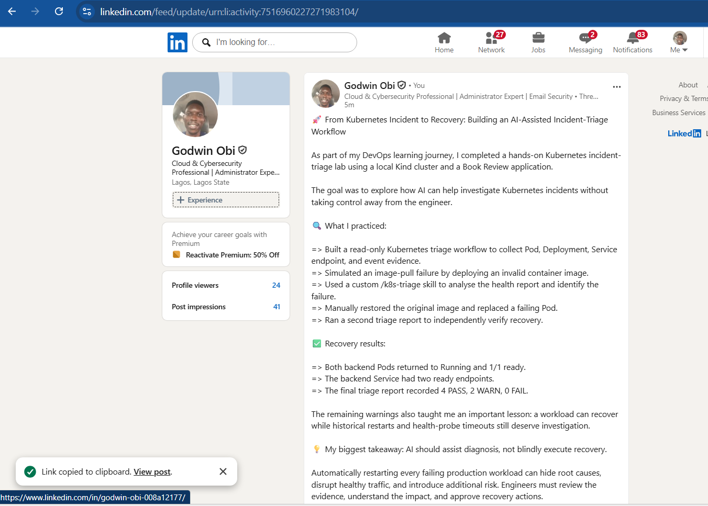

### LinkedIn Post URL

https://www.linkedin.com/posts/godwin-obi-008a12177_devops-kubernetes-aiops-share-7516960226462490624-0D1e/?utm_source=share&utm_medium=member_desktop&rcm=ACoAACn5hogBVyHnSR92cyBf5EzFBZEMSepEVPM

---

# Required Project Files

Include these files in your project repository:

- `CLAUDE.md`
- `lab-config.md`
- `scripts/k8s-triage.sh`
- `.claude/skills/k8s-triage/SKILL.md`
- `reports/incident-failure-report.txt`
- `reports/recovery-report.txt`
- `incident-summary.md`

Your `incident-summary.md` must contain:

1. Reported Symptom
2. Evidence Collected
3. Most Likely Cause
4. Human-Approved Recovery Action
5. Verification
6. Safety Decision
7. Agentic Loop Mapping

---

# Final Summary

## Evidence and Cause

Summarize the evidence and the supported cause of the incident.

The incident was caused by changing the backend Deployment image to the invalid image book-review-backend:incident-invalid. Kubernetes reported ErrImagePull and ImagePullBackOff, and the affected Pod was not ready. The triage report recorded 2 PASS, 2 WARN, 2 FAIL, with an overall status of FAIL and exit code 2.

## Manual Recovery

Describe the command or configuration change you performed.

I manually restored the correct image, book-review-backend:local, using kubectl set image. When a failing Pod continued to experience problems, I deleted that specific Pod and allowed the Kubernetes Deployment controller to create a replacement.

## Verification

Explain how the recovery report and Kubernetes outputs confirmed recovery.

I checked the Deployment Pods and Service endpoints, then reran the read-only triage script to generate a recovery report. Both backend Pods were Running and 1/1 ready, and the Service had two ready endpoints. The final report recorded 4 PASS, 2 WARN, 0 FAIL, with an overall status of WARN and exit code 1. Historical restarts and health-probe timeout warnings remained and require further investigation.

## Safety Decision

Explain how you kept Claude’s role limited to evidence gathering and analysis.

Claude’s /k8s-triage skill was restricted to read-only evidence gathering and analysis. It ran the triage script, reviewed the report, and explained the findings without changing Kubernetes resources. I reviewed the evidence and performed the recovery commands manually. This maintained human oversight, reduced the risk of unintended changes, and ensured that recovery decisions remained under the engineer’s control.

---

# Submission Instructions

- Include all 20 required screenshots under their corresponding Evidence sections.
- Complete all Notes questions in your own words.
- Include the required project files in your linked repository.
- Include your published LinkedIn post URL.
- Use clear, readable screenshots showing relevant commands, configuration, and outputs.
- Display your full name before taking required terminal screenshots.
- Preserve the failure report before recovery.
- Ensure the baseline and recovery reports contain no FAIL results.
- Explain any WARN results remaining after recovery.
- Review reports, logs, configuration records, and screenshots before publishing.
- Do not expose credentials, kubeconfig contents, tokens, certificates, JWT secrets, or confidential account information.

---

# Completion Checklist

- [ ] Confirmed the personal lab context
- [ ] Discovered and recorded application configuration
- [ ] Recorded the original working image
- [ ] Captured healthy Pods and ready Service backends (Screenshot 1)
- [ ] Created the workspace (Screenshot 2)
- [ ] Configured CLAUDE.md (Screenshot 3)
- [ ] Reviewed the five-check triage plan (Screenshot 4)
- [ ] Configured and reviewed the supplied script (Screenshots 5–7)
- [ ] Passed Bash syntax validation and set executable permission (Screenshot 8)
- [ ] Captured a baseline report with no FAIL (Screenshot 9)
- [ ] Captured the correct exit code (Screenshot 10)
- [ ] Configured and invoked `/k8s-triage` (Screenshots 11–12)
- [ ] Simulated one controlled incident manually (Screenshot 13)
- [ ] Reviewed Claude’s failed-state analysis (Screenshot 14)
- [ ] Saved failure evidence before recovery (Screenshot 15)
- [ ] Executed recovery manually and waited for rollout completion
- [ ] Confirmed recovered Pods and ready Service backends (Screenshot 16)
- [ ] Captured recovery analysis with no FAIL (Screenshot 17)
- [ ] Explained any remaining warnings
- [ ] Saved failure and recovery reports (Screenshot 18)
- [ ] Completed the seven-section incident summary (Screenshot 19)
- [ ] Answered all Notes questions
- [ ] Published the LinkedIn post (Screenshot 20)
- [ ] Included the LinkedIn post URL
- [ ] Included all required project files
- [ ] Checked that no sensitive information is exposed

---

## 📌 About DMI & CloudAdvisory

DevOps Micro Internship (DMI) is a project-based DevOps program run by Pravin Mishra (The CloudAdvisory) focused on real-world execution, systems thinking, and career readiness.

It helps learners build strong DevOps foundations with hands-on experience.

---

## 📌 Resources

- 🌐 DMI Official Website: https://dmi.pravinmishra.com?utm_source=github&utm_medium=readme  
- 🎓 University: https://university.pravinmishra.com?utm_source=github&utm_medium=readme  
- 💬 Discord Community: https://discord.pravinmishra.com?utm_source=github&utm_medium=readme  
- 📝 Blog: https://dmi.pravinmishra.com/blog?utm_source=github&utm_medium=readme  
- ▶️ YouTube Playlist: https://www.youtube.com/playlist?list=PLFeSNDtI4Cho  
- 🔗 Pravin Mishra (LinkedIn): https://www.linkedin.com/in/pravin-mishra-aws-trainer/  
- 🏢 CloudAdvisory (LinkedIn): https://www.linkedin.com/company/thecloudadvisory/

---

*This submission is part of DevOps Micro Internship (DMI) — Agentic AI Track.*
